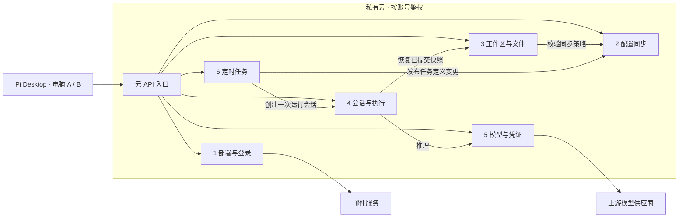
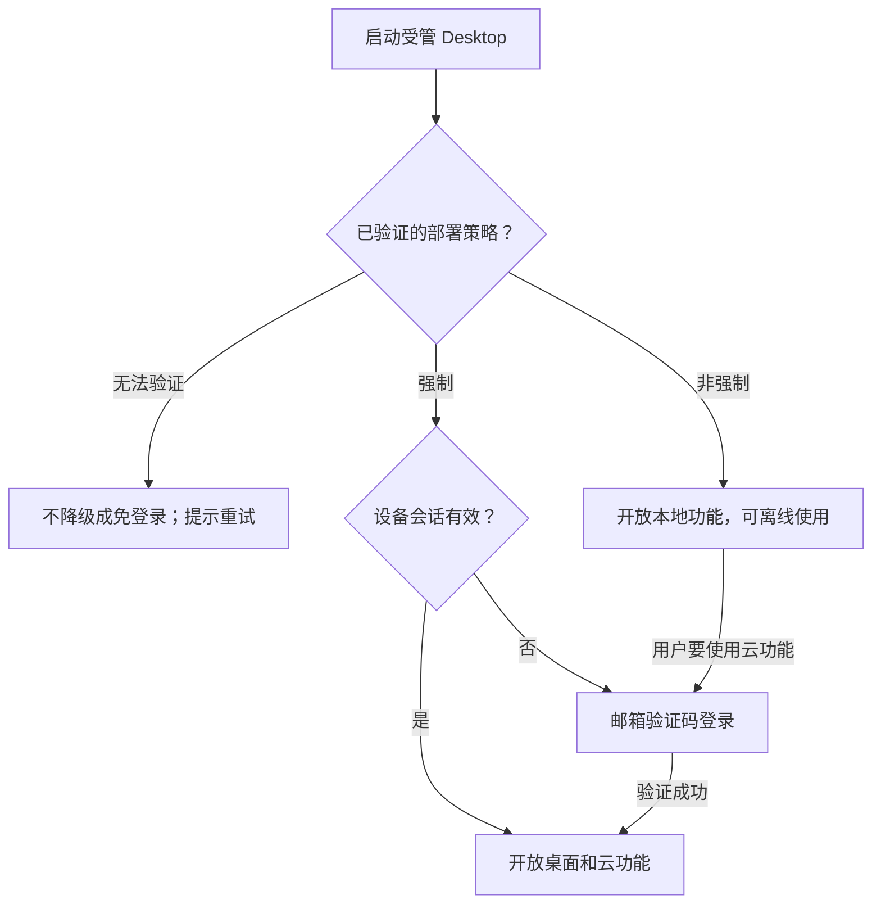
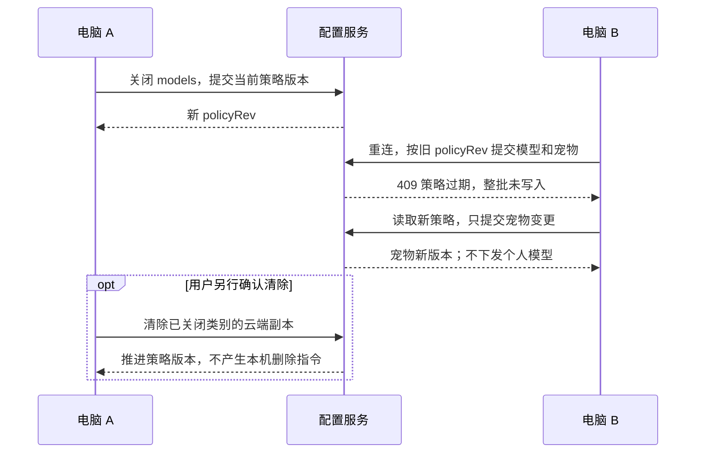
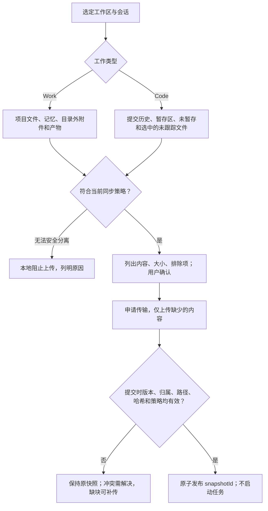
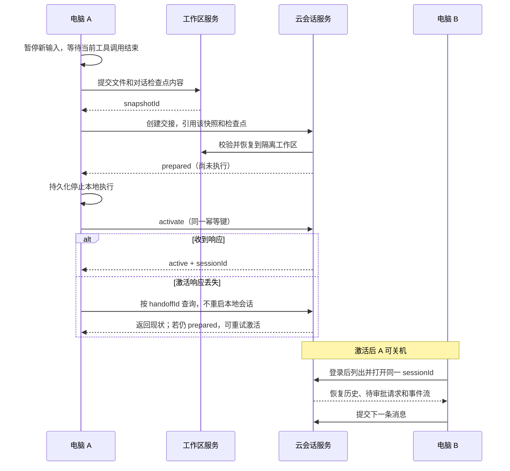
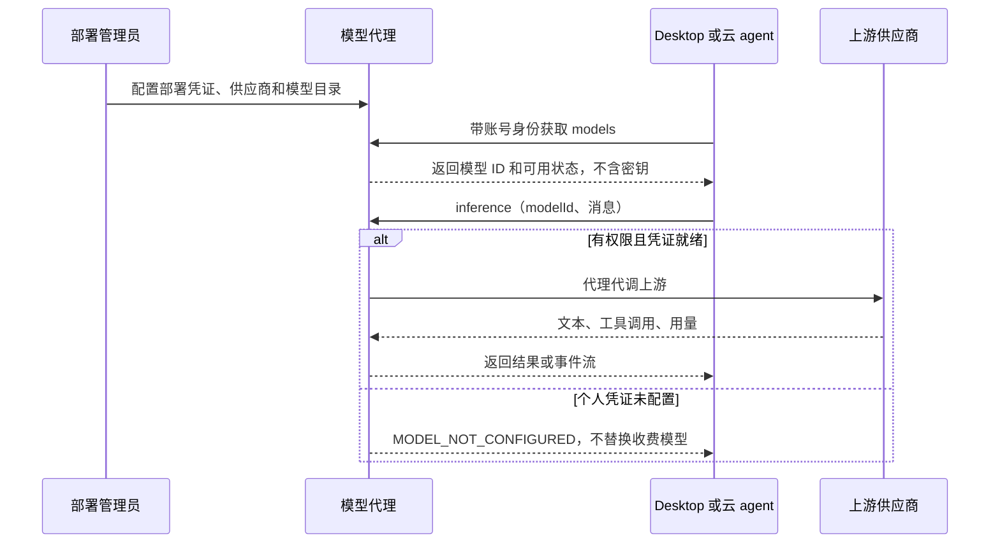
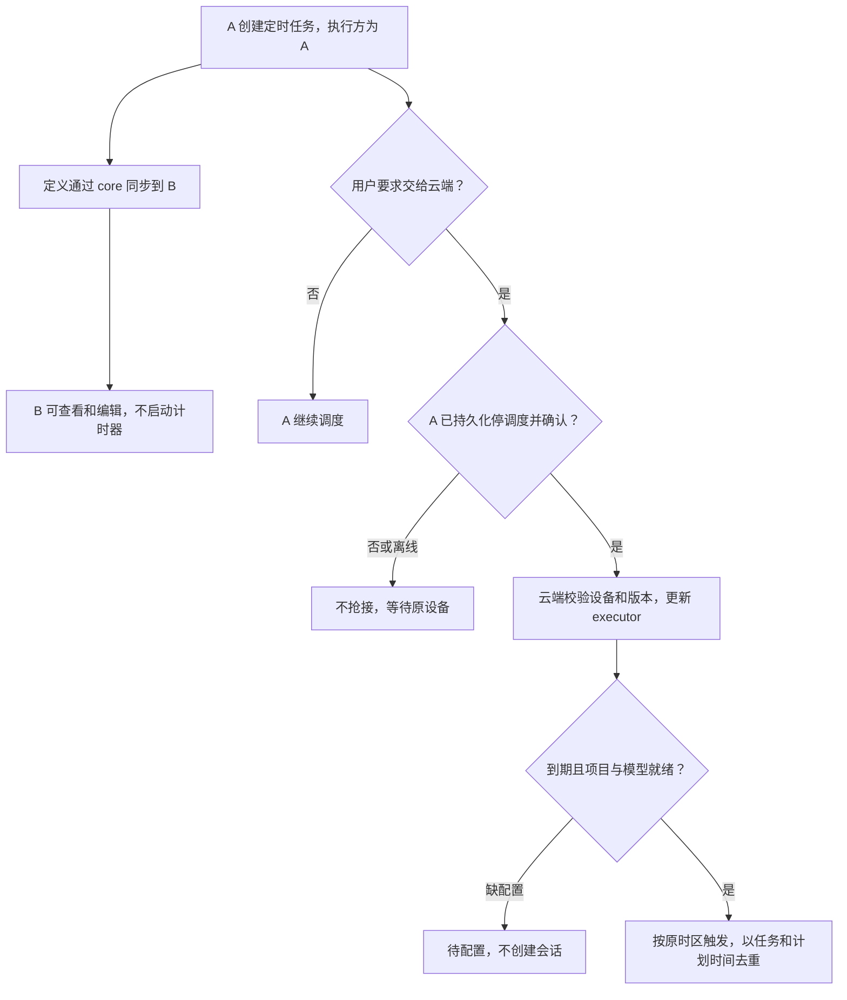

# Pi Desktop 私有云 v1 · 接口与交互设计

**状态：Draft，供桌面端与服务端联调评审；不是已实现的 API。** 首版入口为 Pi Desktop，支持 Work 和 Code。目标是：电脑 A 确认交接后可以关机，电脑 B 登录同一账号即可打开原会话，继续操作原文件。

## 系统边界与模块关系

**同步**复制数据，不获得执行权；**交接**改变执行方；**接续**打开已在云端的会话，不再导入一次。现有[整机远程协议](../src/shared/remote.ts)不提供账号隔离，不作为云端公共 API。



### 公共契约

统一前缀 `/cloud/v1`，HTTPS。下面的 TypeScript 块共同组成一份契约：路由键写明 HTTP 方法和路径；`Http<I,O>` 表示输入和成功输出，路由中的 `:id` 等参数不在请求体重复。GET 输入为查询参数；`void` 输入为无正文，`void` 输出为 `204`。除部署策略读取和认证流程外，每个接口均须验证账号身份；账号标识从访问令牌取得，不信任客户端传入的所有者；`/admin/*` 额外要求部署管理员身份。

```ts
type Http<I, O> = (input: I) => Promise<O>;
type Id = string;
type Rev = number;         // 单个资源的服务端版本；不是分页游标
type Instant = string;     // RFC 3339，带时区
type Digest = string;      // SHA-256，十六进制
type Json = null | boolean | number | string | Json[] | { [key: string]: Json };
type Page<T> = { items: T[]; nextCursor: string; hasMore: boolean };
type ApiError = { code: string; message: string; currentRev?: Rev };
```

写入已有资源带 `baseRev`；版本冲突返回 `409`。提交快照、激活交接、发送消息均带 `Idempotency-Key`：相同账号、操作、键和正文返回原结果；同键不同正文返回冲突。外部不能仅靠资源 ID 或内容哈希跨账号读取数据。

## 1. 部署策略与邮箱登录

### 接口

```ts
interface AuthApi {
  'GET /deployment': Http<void, Deployment>;
  'PATCH /admin/deployment': Http<{ loginRequired: boolean; baseRev: Rev }, Deployment>;
  'POST /auth/email/challenges': Http<{ email: string }, ChallengeReceipt>;
  'POST /auth/email/verify': Http<{ challengeId: Id; code: string; deviceId: Id }, LoginResult>;
  'POST /auth/refresh': Http<{ refreshToken: string }, TokenPair>;
  'POST /auth/logout': Http<void, void>; // 只撤销当前设备会话
}
```

### 数据结构

```ts
interface Deployment { deploymentId: Id; loginRequired: boolean; authMethod: 'email_otp'; rev: Rev }
interface User { id: Id; email: string }
interface ChallengeReceipt { challengeId: Id; expiresAt: Instant; resendAfter: Instant }
interface TokenPair { accessToken: string; refreshToken: string; expiresAt: Instant }
type LoginResult = TokenPair & { user: User };
// 仅服务端持有；验证码、刷新令牌不以明文持久化。
interface EmailChallenge { id: Id; email: string; codeDigest: string; expiresAt: Instant; attemptsLeft: number; usedAt?: Instant }
interface DeviceSession { id: Id; userId: Id; deviceId: Id; refreshTokenDigest: string; expiresAt: Instant; revokedAt?: Instant }
```

### 流程图：启动时是否可用



强制登录的检查先于本地 agent、调度器和远程监听启动。邮箱申请统一返回回执，不暴露账号是否存在；发送和验证分别限流。验证码一次性消费，刷新时轮换令牌。两种部署都不允许匿名读取云工作区或调用内置模型。

## 2. 账号配置同步

### 接口

```ts
interface ConfigApi {
  'GET /me/sync-policy': Http<void, SyncPolicy>;
  'PATCH /me/sync-policy': Http<{ baseRev: Rev; models?: boolean; customize?: boolean }, SyncPolicy>;
  'GET /me/config/changes': Http<{ cursor?: string }, Page<ConfigItem>>;
  'POST /me/config/changes': Http<{ policyRev: Rev; changes: ConfigChange[] }, ItemResult[]>;
  'DELETE /me/config/groups/:group/copy': Http<{ policyRev: Rev }, SyncPolicy>; // 仅已关闭的可选组
}
```

### 数据结构

```ts
type OptionalGroup = 'models' | 'customize';
type ConfigGroup = 'core' | OptionalGroup;
interface SyncPolicy { rev: Rev; models: boolean; customize: boolean }
type Scope = { kind: 'account' } | { kind: 'workspace'; workspaceId: Id };
type ItemKey = { scope: Scope; key: string };
type EditValue = { op: 'put'; value: Json } | { op: 'delete' };
type ConfigChange = ItemKey & EditValue & { baseRev: Rev };
type ConfigItem = ItemKey & EditValue & { group: ConfigGroup; rev: Rev };
type ItemResult = ItemKey & ({ status: 'saved'; rev: Rev } | { status: 'conflict'; currentRev: Rev });
```

服务端按键确定分组，并按该键的 schema 校验 `value`，不接收任意文件。首次无游标读取为快照；后续为增量，含删除记录。客户端不仅要处理桌面 JSON，还要覆盖 SDK 用户及项目配置、`localStorage` 中的用户选择。

| 分组 | 包含 | 边界 |
|---|---|---|
| `core`，必须同步 | 外观、通知、通用 AI 开关、隐私规则、可移植会话偏好、宠物及自制皮肤、任务定义、搜索和 S3 的非秘密设置 | “启用输入预测”是通用项；“用哪个个人模型预测”不是 |
| `models`，可关闭 | 个人供应商、端点、模型参数、默认及按功能指定的模型 | 不含 Key、OAuth 凭证或取密钥命令 |
| `customize`，可关闭 | 用户及项目级 skills、提示模板、MCP 定义、插件来源和自制插件内容、子 agent | 不含 MCP 密钥、插件私有数据；新环境重新授权执行权限 |
| 不进入同步流 | 本机路径、监听状态、设备令牌、窗口位置、缓存和请求日志 | 各设备绑定路径，个人凭证在云端单独录入 |

### 时序图：关闭模型同步时，B 有离线修改



关闭只暂停账号所有设备的双向传输，不删除云端副本。重新开启时先比对差异；不能把清除前的离线队列直接重放。

## 3. 工作区与文件同步

### 接口

```ts
interface WorkspaceApi {
  'POST /workspaces': Http<{ kind: Workspace['kind']; name: string }, Workspace>;
  'GET /workspaces': Http<void, Workspace[]>;
  'POST /workspaces/:id/transfers': Http<{ baseRev: Rev; policyRev: Rev; manifest: Manifest }, UploadPlan>;
  'PUT /transfers/:id/blobs/:hash': Http<Uint8Array, void>;
  'POST /transfers/:id/commit': Http<void, SnapshotRef>;
  'GET /transfers/:id': Http<void, TransferStatus>;
  'GET /workspaces/:id/manifest': Http<{ sinceRev?: Rev }, { rev: Rev; manifest: Manifest }>;
  'GET /workspaces/:id/blobs/:hash': Http<void, Uint8Array>;
}
```

### 数据结构

```ts
interface Workspace { id: Id; ownerId: Id; kind: 'work' | 'code'; name: string; rev: Rev }
interface DeviceBinding { workspaceId: Id; localRoot: string; lastSyncedRev: Rev } // 仅本机
interface FileRef { path: string; hash: Digest; size: number; mode?: number }     // 工作区相对路径
// put 和 delete 都有路径；只有 put 引用内容。
type FileChange = ({ op: 'put' } & FileRef) | { op: 'delete'; path: string };
type Manifest = { changes: FileChange[]; checkpointFiles?: FileRef[]; snapshot?: WorkSnapshot | CodeSnapshot };
interface WorkSnapshot {
  kind: 'work'; instructions: string; links: string[]; memory: string;
  attachments: FileRef[]; artifacts: FileRef[];
}
interface CodeSnapshot {
  kind: 'code'; gitBundle: FileRef; branch: string; baseCommit: string; headCommit: string;
  stagedPatch: FileRef; unstagedPatch: FileRef; untrackedFiles: FileRef[];
}
interface UploadPlan { transferId: Id; missingHashes: Digest[] }
interface SnapshotRef { snapshotId: Id; rev: Rev }
type TransferStatus = { state: 'uploading' } | { state: 'committed'; result: SnapshotRef } | { state: 'failed'; error: ApiError };
```

### 流程图：从本机预检到快照发布



Work 后续按版本双向传输变更；两个设备修改同一文件时保留双方内容，不按时间戳覆盖。关闭 `customize` 时不仅要检查项目内的 `.pi/` 和 `.agents/skills/`，还要在上传前检查 Git 历史是否包含明确排除的内容。

## 4. 会话交接与云端执行

### 接口

```ts
interface SessionApi {
  'POST /workspaces/:id/handoffs': Http<{ sourceSessionId: Id; snapshotId: Id; checkpoint: Checkpoint }, Prepared>;
  'POST /handoffs/:id/activate': Http<void, Active>;
  'GET /handoffs/:id': Http<void, Handoff>;
  'GET /workspaces/:id/sessions': Http<void, CloudSession[]>;
  'GET /sessions/:id': Http<void, SessionDetail>;
  'POST /sessions/:id/prompts': Http<{ messageId: Id; text: string; attachments?: FileRef[] }, { turnId: Id }>;
  'POST /sessions/:id/decisions': Http<{ requestId: Id; decision: 'allow' | 'deny' }, void>;
  'POST /sessions/:id/abort': Http<{ turnId: Id }, void>;
  'GET /sessions/:id/events': Http<void, AsyncIterable<SessionEvent>>; // SSE；Last-Event-ID 请求头
}
```

### 数据结构

```ts
interface Checkpoint {
  transcriptRef: FileRef; workdirRelative: string; modelRef?: Id;
  permissionMode: string; attachmentMap: Record<Id, FileRef>;
}
type Prepared = { handoffId: Id; state: 'prepared' };
type Active = { handoffId: Id; state: 'active'; sessionId: Id };
type Handoff = Prepared | Active | { handoffId: Id; state: 'failed'; error: ApiError };
interface CloudSession { id: Id; workspaceId: Id; status: 'idle' | 'running' | 'waitingApproval' }
interface SessionEvent { id: string; type: string; payload: Json } // 事件体复用已有 HostEvent 语义
interface SessionDetail extends CloudSession { history: Json[]; pendingApprovals: { requestId: Id; description: string }[] }
```

### 时序图：A 交接，B 在 A 关机后接续



会话只能在所属账号和工作区内访问。断线不终止云任务，也不自动批准待审批操作；事件游标过期时重读会话详情。首版不迁移正在运行的终端进程。

## 5. 内置模型与凭证

### 接口

```ts
interface ModelApi {
  'PUT /admin/providers/:id': Http<ProviderDraft, ProviderInfo>;
  'DELETE /admin/providers/:id': Http<{ baseRev: Rev }, void>;
  'PUT /admin/credentials/:ref': Http<SecretInput, SecretStatus>;
  'DELETE /admin/credentials/:ref': Http<void, void>;
  'PUT /me/credentials/:ref': Http<SecretInput, SecretStatus>;
  'DELETE /me/credentials/:ref': Http<void, void>;
  'GET /models': Http<void, ModelInfo[]>;
  'POST /inference': Http<InferenceInput, InferenceResult | AsyncIterable<InferenceEvent>>;
}
```

### 数据结构

```ts
interface ProviderDraft { baseRev: Rev; protocol: string; baseUrl: string; models: Id[]; secretRef: Id; enabled: boolean }
interface ProviderInfo { id: Id; scope: 'deployment' | 'account'; enabled: boolean; rev: Rev }
interface ModelInfo { id: Id; name: string; source: 'managed' | 'personal'; availability: 'ready' | 'needsCredential' }
interface SecretInput { value: string }  // 仅写入云凭证接口，不进配置同步
interface SecretStatus { configured: boolean }
interface InferenceInput { modelId: Id; messages: Json[]; tools?: Json[]; stream: boolean }
interface InferenceResult { text: string; toolCalls: Json[]; usage: { input: number; output: number } }
type InferenceEvent = { type: 'text'; delta: string } | { type: 'toolCall'; call: Json } | { type: 'done'; usage: InferenceResult['usage'] };
```

### 时序图：登录即用，不下发上游密钥



个人凭证在云端单独录入，没有读取明文接口。部署级上游密钥既不下发桌面，也不注入用户工作区。关闭个人模型同步不影响管理员提供的模型。

## 6. 定时任务与执行归属

### 接口

```ts
interface ScheduleApi {
  'GET /schedules/:id': Http<void, Schedule>;
  'PUT /schedules/:id': Http<ScheduleDefinition & { baseRev: Rev }, Schedule>;
  'POST /schedules/:id/claim-cloud': Http<{ baseRev: Rev }, Schedule>;
  'GET /schedules/:id/runs': Http<void, ScheduleRun[]>;
}
```

### 数据结构

```ts
type Executor = { kind: 'device'; deviceId: Id } | { kind: 'cloud' };
type Rule = { type: 'manual' | 'hourly' } | { type: 'daily' | 'weekdays'; time: string }
  | { type: 'weekly'; day: number; time: string } | { type: 'once'; at: Instant } | { type: 'cron'; expr: string };
interface ScheduleDefinition {
  name: string; prompt: string; workspaceId: Id | null; rule: Rule;
  timeZone: string; modelRef?: Id; enabled: boolean;
}
interface Schedule extends ScheduleDefinition { id: Id; rev: Rev; executor: Executor; nextRunAt: Instant | null }
interface ScheduleRun { scheduleId: Id; scheduledFor: Instant; status: 'started' | 'skipped'; sessionId?: Id }
```

### 流程图：同步任务定义不等于接管计时器



任务定义在 `core` 中只有一份，普通设置写入不能改 `executor`。运行以 `(scheduleId, scheduledFor)` 唯一标识；两台设备在线也不应为同一计划时间创建两个云会话。

## 待评审问题

1. **登录**：部署策略如何验证？强制部署的已登录设备断网后是否有宽限期？
2. **配置**：重新开启时如何展示和合并暂停期间的修改？清除如何处理历史备份？
3. **文件**：分块、配额和未完成上传回收策略是什么？Git 历史不能安全上传时是否支持替代导入？
4. **执行**：云工作区的账号隔离、网络和资源配额如何落实？`prepared` 长期未激活时如何取消和恢复？
5. **调度**：交接时恰好到期的一次由谁执行？原设备丢失后怎样安全地人工接管？
