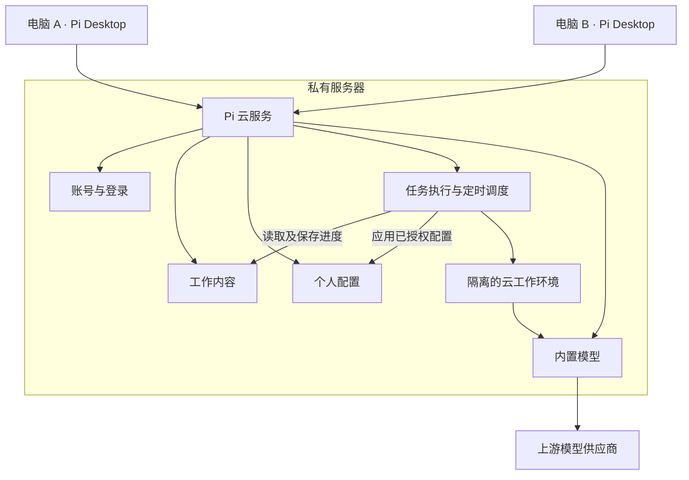
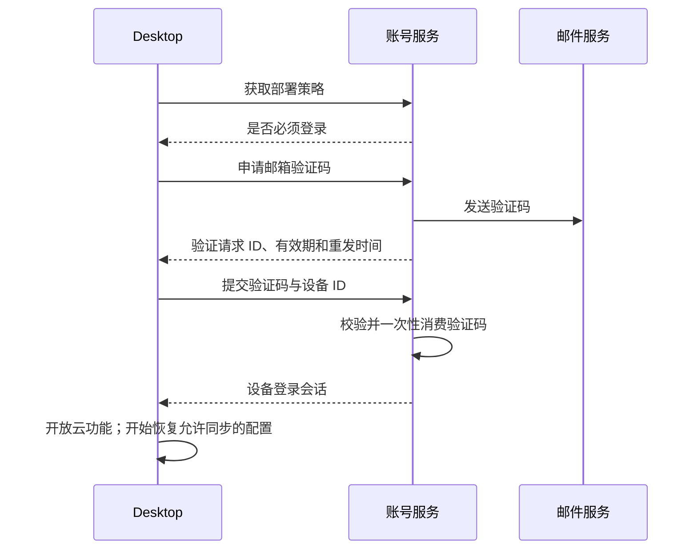
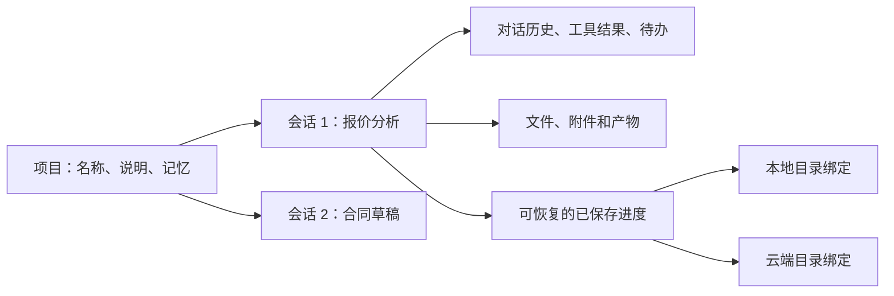
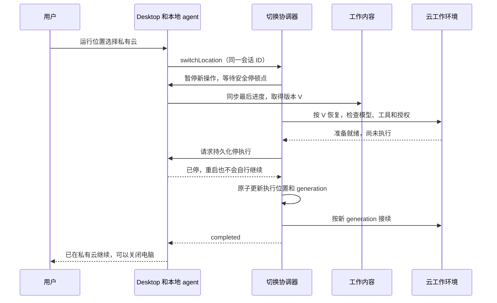
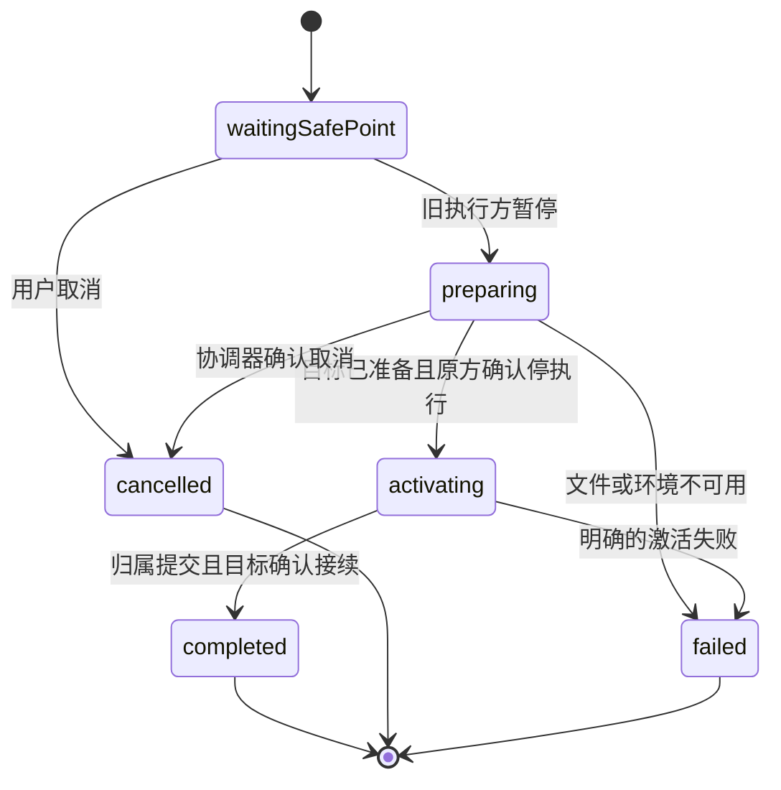
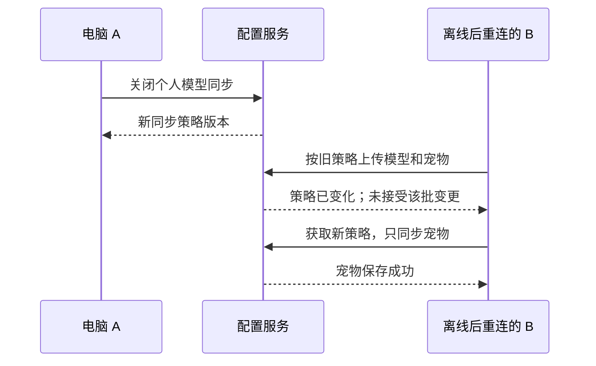
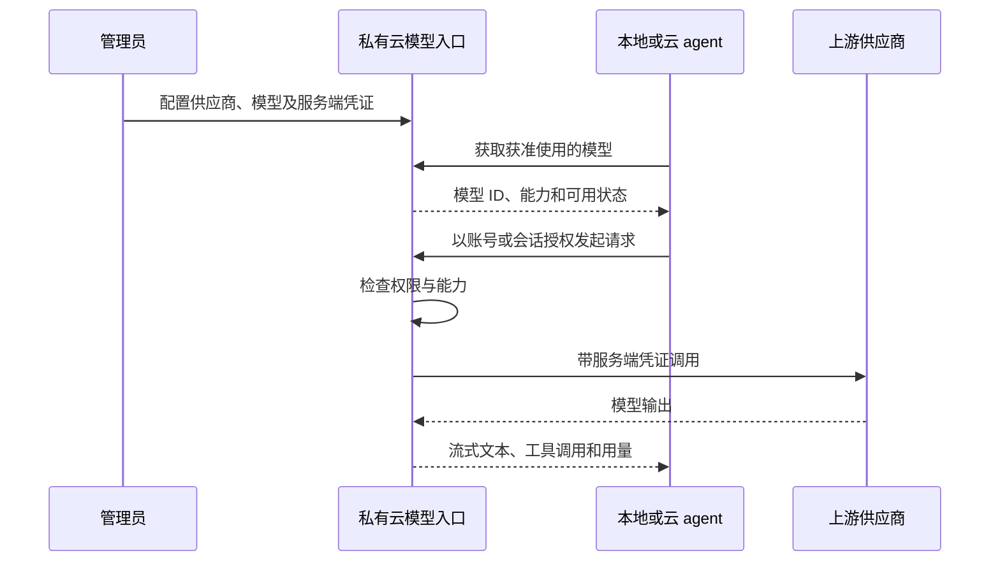

# Pi Desktop 私有云设计

> 状态：Draft。本文按已确认的产品方向重新编写，替代此前的手动上传、交接方案；尚未实现。

## 1. 使用起来是什么样？

**工作和配置跟账号走，同一会话选择「本地 / 私有云」。准备文件和接续由系统完成。** 私有云是用户或公司自行部署的服务器，不是要求所有人使用同一个公共服务。

你在公司电脑上让 Pi 整理供应商报价，准备下班时，把当前会话的运行位置从「本地」改成「私有云」。Pi 显示“正在同步文件并准备环境”；完成后显示“已在私有云继续”。这时可以关掉公司电脑。回家登录另一台 Pi Desktop，打开的仍是同一段对话，表格和进度都在。

```text
整理供应商报价                    运行位置：本地 ▾

你：把三份报价整理成表格。
Pi：正在读取附件……

切换为「私有云」
  → 正在准备
  → 已在私有云继续
  → 现在可以关闭电脑
```

| 用户操作 | 系统行为 |
|---|---|
| 首次登录 | 恢复账号配置；本机已有工作在用户确认范围后导入，不上传整台电脑 |
| 在本地工作 | 已授权内容后台同步；本地执行仍在这台电脑上 |
| 将会话切换到私有云 | 自动同步最新进度、准备环境并接续；不要求手工上传或操作“交接” |
| 在另一台电脑打开云会话 | 查看同一份历史、文件和运行状态，继续输入或审批 |
| 将云会话切回本地 | 自动准备当前电脑的工作目录，确认云端停下后在本地继续 |
| 修改设置、宠物或定时任务 | 账号内同步；个人模型和自定义内容可分别关闭同步 |
| 使用管理员提供的模型 | 登录后直接选择使用；本地会话和云会话都支持 |

首版只做桌面端，同时支持 Work（当前界面入口为 Chat）和 Code。**断网或关机不会自动把本地任务转到云端。** 切换成功前关闭原电脑，无法保证接续。暂停或停止云运行不删除已经保存的文件与对话；退出桌面连接也不等于停止云任务。

## 2. 系统结构



五个模块可以先在一个服务中实现，不默认拆成微服务。云工作环境单独隔离，因为它会执行用户的命令、插件和 MCP 工具。它不能访问账号数据库、服务器管理密钥或其他用户目录。

| 模块 | 拥有的数据 | 不负责什么 |
|---|---|---|
| 账号与登录 | 部署登录策略、账号、设备会话 | 不决定工作文件和设置的同步范围 |
| 工作内容 | 项目、对话历史、文件、附件、已保存进度 | 不根据“已同步”自行启动任务 |
| 任务执行与定时调度 | 会话执行位置、切换操作、任务定义和运行记录 | 不维护第二份项目或通用配置 |
| 个人配置 | 设置、自定义内容、模型同步开关及配置版本 | 只分发定时任务的变更，不另存一份任务真相 |
| 内置模型 | 部署供应商、可用模型目录、调用权限及服务端凭证 | 不因使用模型而改变会话运行位置 |

### 接口约定

以下 TypeScript 定义模块的业务接口，不是最终 HTTP 路由，也不是数据库表。每个接口的账号由已验证的请求身份取得；客户端不能传入另一个账号 ID 来访问其资源。

- `expectedRevision` 是调用方上次看到的版本；不匹配时拒绝覆盖并返回当前版本。
- `requestId` 用于安全重试。同一账号、操作和请求 ID 的相同内容返回同一结果；同键不同内容报错。
- 长操作返回操作 ID，桌面订阅进度；重连先查询状态，不靠反复重发命令猜测结果。
- 时间使用带时区的 RFC 3339 字符串；定时计划另保存 IANA 时区，不跟随服务器时区变化。

```ts
type Id = string;
type Revision = number;
type Timestamp = string;
type Json = null | boolean | number | string | Json[] | { [key: string]: Json };
interface ContentRef { sha256: string; size: number }
interface Page<T> { items: T[]; nextCursor: string | null }
type RunTarget = { kind: 'local'; deviceId: Id } | { kind: 'cloud' };
type PermissionMode = 'auto' | 'default' | 'acceptEdits' | 'plan' | 'bypass';
```

## 3. 账号与登录

### 用户看到的行为

管理员可指定是否必须登录。非强制部署允许不登录做本地工作；同步、云执行和内置模型仍须登录。强制部署先验证身份，再开放本地 agent、定时调度和远程入口。首版只有邮箱加验证码，不包含密码、第三方社交登录或企业 SSO。

### 数据结构与接口

```ts
interface DeploymentPolicy {
  deploymentId: Id;
  requireLogin: boolean;
  revision: Revision;
}
interface LoginSession {
  accountId: Id;
  deviceSessionId: Id;
  accessToken: string;
  refreshToken: string;
  expiresAt: Timestamp;
}
interface AccountApi {
  getPolicy(): Promise<DeploymentPolicy>;
  setPolicy(requireLogin: boolean, expectedRevision: Revision): Promise<DeploymentPolicy>; // 管理员
  sendEmailCode(email: string): Promise<{ challengeId: Id; expiresAt: Timestamp; resendAfter: Timestamp }>;
  login(challengeId: Id, code: string, deviceId: Id): Promise<LoginSession>;
  refresh(refreshToken: string): Promise<LoginSession>;
  logout(): Promise<void>; // 撤销当前设备的登录，不删除云数据
}
```

### 登录流程



验证码限时、限次、不可复用；申请接口统一响应，不泄露邮箱是否已注册。刷新令牌轮换，退出后不能再续期。设备 ID 只是标识，不能代替认证。桌面登录凭证不放进工作目录、不进入配置同步、不交给插件。

受管部署地址与强制登录要求来自管理员控制的安装配置，不能通过修改普通账号设置解除。是否给已登录设备提供离线宽限期尚待确认；在决定前，不能把“联系不上服务器”实现成自动免登录。强制登录约束的是受管客户端，不声称能阻止用户在自己的电脑运行另装的软件。

## 4. 工作内容：同一份工作如何跨设备保存？

### 项目、会话、文件的关系

项目保存说明和记忆；会话保存一次工作的对话与进度；工作目录保存真实文件。项目 ID 不等于本机路径，会话 ID 不因切换运行位置而改变。



### 数据结构

```ts
interface Project {
  id: Id; name: string; instructions: string; memory: string;
  links: { title: string; url: string }[];
  linkedCodeProjects: Id[];
}
interface Conversation {
  id: Id; projectId: Id; kind: 'work' | 'code'; title: string;
  parentId?: Id;
  modelId?: Id;
  permissionMode: PermissionMode;
}
interface FileEntry { path: string; content: ContentRef; executable: boolean }
interface GitState {
  head: string; branch: string | null; baseCommit: string;
  historyBundle: ContentRef;
  stagedChanges: ContentRef;
  unstagedChanges: ContentRef;
  untrackedFiles: FileEntry[];
}
interface Checkpoint {
  conversationId: Id;
  history: { format: string; version: number; content: ContentRef };
  files: FileEntry[];
  attachments: FileEntry[];
  artifacts: FileEntry[];
  git?: GitState;
}
interface LocalBinding {
  projectId: Id; conversationId: Id; root: string; lastSyncedRevision: Revision;
}
interface SyncConsent {
  projectId: Id; conversationIds: Id[];
  roots: string[]; excludedPaths: string[]; // 本机授权记录，不是任意远程读取路径
}
interface SyncStatus {
  state: 'syncing' | 'synced' | 'conflict' | 'error';
  lastSyncedAt?: Timestamp;
  issues: { path?: string; reason: string }[];
}
```

### 接口

```ts
interface WorkApi {
  listProjects(): Promise<Project[]>;
  listConversations(projectId: Id): Promise<Conversation[]>;
  createProject(project: Omit<Project, 'id'>, requestId: Id): Promise<Project>;
  enableSync(consent: SyncConsent): Promise<void>; // 桌面侧保存授权，注册云端逻辑对象
  getSyncStatus(projectId: Id): Promise<SyncStatus>;
  readCheckpoint(conversationId: Id): Promise<{ revision: Revision; checkpoint: Checkpoint }>;
  // 以下由同步器调用，不是用户要操作的步骤。
  prepareSave(checkpoint: Checkpoint, expectedRevision: Revision, policyRevision: Revision):
    Promise<{ uploadId: Id; missing: ContentRef[] }>;
  upload(uploadId: Id, content: ContentRef, bytes: Uint8Array): Promise<void>;
  finishSave(uploadId: Id, requestId: Id): Promise<{ revision: Revision }>;
  download(conversationId: Id, revision: Revision, content: ContentRef): Promise<Uint8Array>;
}
```

### 同步规则

第一次确认哪些历史工作上云，此后在授权范围内后台同步。项目外附件、链接的 Code 仓库不能仅凭一条引用自动加入授权。文件清单使用相对路径；服务端拒绝路径越界、符号链接逃逸及目标系统上的名称碰撞。

- **Work**：保存项目说明、记忆、完整会话、文件附件和产物。会话历史包含工具结果、待办等自定义条目，不能只导出聊天文字。项目上下文单独版本化；多个会话引用同一份项目记忆，不复制成互相覆盖的副本。
- **Code**：除了 Work 共用的历史和附件，还保存 Git 提交、分支、暂存和未暂存改动及选中的未跟踪文件。不复制机器凭证、Git hooks 和依赖安装目录。Git bundle 本身不包含工作树，不能把它当完整备份。
- **增量**：内容按摘要复用，只传缺少的数据。文件、历史和 Git 状态组成一致的检查点；所有引用校验通过后才发布，失败仍保留上一版。一次上传期间策略改变也要重新检查。
- **冲突**：以最近共同版本比较；单边改动可自动合并，同一路径两端修改或删除保留双方并要求选择。运行中的工作目录不接受同步器直接覆盖，在安全停顿点应用外部变更。多个本地会话共享同一目录时，切换前需一起暂停写入者，或提示暂不能切换。
- **代码特例**：未解决合并、缺失的 LFS 内容、无法恢复的子模块，先阻止切换并说明原因。禁止上传的配置若已进入 Git 历史，不能只过滤最新目录就上传历史。

同一文件夹不自动变成实时协作文档。首版不承诺多人同时编辑，也不恢复纯内存侧聊、进程内状态或正在运行的终端。不能理解的历史格式报告“不支持接续”，不能静默降级成摘要。

## 5. 任务执行：切换运行位置，而不是让用户搬数据

### 数据结构与接口

```ts
interface ConversationRuntime {
  conversationId: Id;
  target: RunTarget;
  generation: number; // 每次成功切换递增，用来拒绝旧执行器的命令
  state: 'idle' | 'running' | 'switching' | 'waitingApproval' | 'interrupted';
}
interface SwitchOperation {
  id: Id; conversationId: Id; from: RunTarget; to: RunTarget;
  phase: 'waitingSafePoint' | 'preparing' | 'activating' | 'completed' | 'failed' | 'cancelled';
  issue?: string;
}
interface ExecutionApi {
  switchLocation(conversationId: Id, target: RunTarget, expectedGeneration: number, requestId: Id): Promise<SwitchOperation>;
  getSwitch(operationId: Id): Promise<SwitchOperation>;
  cancelSwitch(operationId: Id): Promise<SwitchOperation>;
  getRuntime(conversationId: Id): Promise<ConversationRuntime>;
  sendMessage(conversationId: Id, text: string, generation: number, requestId: Id): Promise<{ turnId: Id }>;
  decide(conversationId: Id, approvalId: Id, allow: boolean, generation: number): Promise<void>;
  stopTurn(conversationId: Id, turnId: Id, requestId: Id): Promise<void>;
  subscribe(conversationId: Id, after?: string): AsyncIterable<{ cursor: string; type: string; payload: Json }>;
}
```

`switchLocation` 是用户唯一需要理解的切换操作。`from` 在切换完成前仍是执行位置；界面显示目标和进度，不能在点击时就写“已在云端运行”。`local` 指指定的设备，不是抽象的“任意本地电脑”。另一设备要本地继续，也须走同一切换流程。

### 本地切换到云端



安全停顿点要求：当前工具与其子任务已停止写入、会话状态已保存、工作目录一致。后台命令或终端仍在修改文件时，提示用户等待或停止，不复制半写入文件。切换保留权限模式；原先需要确认的动作仍需确认。

首次登记本地会话时，来源设备持有初始执行代次；再次导入同一会话不能重置归属或重新授予执行权。切换中不可新增执行输入；用户草稿保留在界面，完成后再发送，不能在两端分别排队。

云端切回本地沿用同一过程：云端停在安全点 → 当前电脑下载最新进度并检查运行条件 → 云端持久化停执行 → 更新执行位置 → 本地继续。准备本地目录时不能覆盖用户已有修改；有差异先解决冲突。本机浏览器状态、桌面应用、某个仅本地可访问的 MCP 不会凭空出现在云端，缺少必需能力时切换被阻止。

### 切换状态和故障处理



- 同一会话一次只能有一个未完成切换。协调器持久化操作结果；激活与取消只能有一个胜出。启动、续跑和保存结果都核对执行代次，过期执行器不能提交。
- 准备失败且确认未转移时，可恢复原执行方；原方已停但结果未知时，保持暂停并查询同一操作，不能凭超时在两边同时重启。
- `failed` 不代表一定回到原位置。若执行归属已改但目标启动失败，`getRuntime` 保持新位置并显示已中断，可显式恢复或再次切换；不自动回滚外部工具的效果。
- 原设备离线时，不从最后备份冒充最新现场，也不抢接。云端进程崩溃后可恢复已保存进度，但外部命令效果不明的步骤标为中断，等待确认，不能承诺“恰好执行一次”。
- 断开客户端只断连接。重连先读取状态与待审批请求，再续接事件；过期游标要求重读，不把事件重放变成重复执行。

### 云工作环境

每个工作环境只挂载被授权的目录；配置和秘密按需授予，账号刷新令牌、管理员密钥不进入 agent 进程。一个用户不能通过 shell、插件或文件 API 访问另一用户。云文件持久保存，环境进程可停止或重建；依赖安装与工作内容分开。具体隔离技术和资源上限属于实现选择，但隔离不是可选项。

### 定时任务

定时任务设置自动同步，执行位置单独明确。同步到 B 不能在 B 自动启动第二个计时器。关闭桌面仍要运行的任务须选择私有云。

```ts
type ScheduleRule = { type: 'manual' | 'hourly' }
  | { type: 'daily' | 'weekdays'; time: string }
  | { type: 'weekly'; day: number; time: string }
  | { type: 'once'; at: Timestamp } | { type: 'cron'; expression: string };
interface ScheduledTask {
  id: Id; revision: Revision; name: string; prompt: string;
  projectId: Id | null; kind: 'work' | 'code'; worktree: boolean;
  modelId?: Id; permissionMode: PermissionMode;
  rule: ScheduleRule; timeZone: string; enabled: boolean;
  target: RunTarget;
}
interface TaskRun {
  taskId: Id; scheduledFor: Timestamp;
  state: 'queued' | 'running' | 'finished' | 'blocked' | 'interrupted';
  conversationId?: Id;
}
interface ScheduleApi {
  create(task: Omit<ScheduledTask, 'id' | 'revision'>, requestId: Id): Promise<ScheduledTask>;
  save(task: Omit<ScheduledTask, 'revision' | 'target'>, expectedRevision: Revision, requestId: Id): Promise<ScheduledTask>;
  setTarget(taskId: Id, target: RunTarget, expectedRevision: Revision, requestId: Id): Promise<{ operationId: Id }>;
  getTargetOperation(operationId: Id): Promise<{ phase: 'preparing' | 'completed' | 'failed'; issue?: string }>;
  runs(taskId: Id): Promise<TaskRun[]>;
}
```

任务定义由此模块持有，变更通过配置同步通道发布。配置导入和界面保存都走同一校验入口，不能更改 `target` 绕过切换。`create` 使用创建者明确选择的位置；本地目标只允许当前已认证设备，创建即登记执行归属。`save` 只修改已创建任务的定义。

切换执行位置时，旧调度器先在触发锁内冻结，报告已领取的计划时刻，新调度器再接管后续时刻；以 `(taskId, scheduledFor)` 唯一标识并幂等创建运行会话。已开始的运行不随任务定义切换，需单独切换那个会话。旧设备不在线时等待，不自动抢接。记录缺项目、工具或模型的阻塞原因，不跳过检查运行。

## 6. 个人配置：账号同步，按环境应用

### 哪些内容跟着账号？

| 类别 | 内容 | 应用位置与边界 |
|---|---|---|
| 必须同步 | 外观、语言、快捷键、通知、隐私规则、宠物与自制皮肤、通用 AI 设置、可移植会话偏好、定时任务定义、搜索和对象存储的非秘密设置 | 桌面设置在各桌面生效；任务和执行参数在相应执行环境生效 |
| 个人模型，可关闭 | 个人供应商、端点、模型参数、默认模型、按功能选择的个人模型 | 不含管理员内置目录；不上传个人 Key/OAuth 凭证 |
| 自定义，可关闭 | 用户及项目级 skills、提示模板、MCP 定义、插件来源和自制插件、子 agent | 桌面页面留在桌面，工具与 host 扩展部署到执行环境；不是复制本机安装产物 |
| 设备绑定与秘密，不直接同步 | 本机目录、终端程序路径、登录令牌、远程监听、供应商与 MCP/S3 密钥 | 路径按设备绑定，凭证在云端单独配置；云副本存在不等于已可执行 |

“任何可配置项”都必须登记归属，包括渲染进程保存的快捷选择，不能因为不在 `settings.json` 就遗漏。缓存、请求日志、窗口坐标和插件私有运行数据不是可移植用户设置。字体或工具在目标设备不存在时保留选择、报告不可用，不静默宣称恢复成功。普通设置和密钥混存的文件必须拆字段处理。

### 数据结构与接口

```ts
type ConfigCategory = 'general' | 'models' | 'customize';
interface SyncPreferences { revision: Revision; models: boolean; customize: boolean }
interface ConfigKey { scope: 'account' | { projectId: Id }; name: string }
type ConfigMutation = { key: ConfigKey; baseRevision: Revision }
  & ({ op: 'put'; value: Json } | { op: 'delete' });
interface ConfigItem { key: ConfigKey; revision: Revision; deleted: boolean; value?: Json }
interface ConfigurationApi {
  getSyncPreferences(): Promise<SyncPreferences>;
  setSyncPreferences(value: Pick<SyncPreferences, 'models' | 'customize'>, expectedRevision: Revision): Promise<SyncPreferences>;
  changes(cursor?: string): Promise<Page<ConfigItem>>;
  apply(changes: ConfigMutation[], policyRevision: Revision, requestId: Id): Promise<ConfigItem[]>;
  clearCloudCopy(category: 'models' | 'customize', expectedPolicyRevision: Revision): Promise<SyncPreferences>;
}
```

每个业务键由服务端决定类别及 schema；`Json` 是传输容器，不代表接受任意配置文件。批量写入在同一事务内检查策略、全部版本和各模块约束，再保存全部变更；任一项失败则整批不写。插件安装、界面刷新等副作用在提交成功后处理。任务与模型资源不允许绕过其专用约束。

### 账号级开关



关闭某类后，所有设备停止该类上传和下载；其他内容必须继续同步。云端已有副本保留，云环境也不会因为关闭同步而卸载正在使用的组件。清除云端副本是独立确认操作，须先关闭该类别，不传播成删除本机文件。重新开启先比对差异；策略版本推进，旧队列不能直接复活已清除的内容。

项目文件上传同样受规则限制，不能从 `.pi/`、`.agents/skills/` 或 Git 历史绕过自定义开关。插件执行授权和项目可信状态不跨环境自动授予。模型同步关闭后，历史对话与定时任务中记载的模型 ID 不改写，但缺少该模型时必须提示用户。

同一配置两端修改采用共同版本比较；同项冲突先展示本地与云端值，不按最后到达时间覆盖。清除后哪些运行中实例需要重载，取决于使用关系；重载须在安全点完成，不能因清除同步副本破坏正在执行的工具。

## 7. 内置模型：登录就能用，本地和云端共用

管理员在私有服务器配置供应商、模型和上游凭证。用户登录后，模型选择器直接显示获准使用的模型。**使用内置模型不要求把整个会话切到云端**；本地 agent 也通过私有云的模型入口调用。

### 数据结构与接口

```ts
type ModelCapability = 'text' | 'image' | 'tools';
interface ManagedModel {
  id: Id; name: string; capabilities: ModelCapability[];
  availability: 'ready' | 'disabled' | 'needsCredential';
}
interface ProviderDraft {
  name: string; protocol: string; baseUrl: string; credentialRef: Id;
  models: { id: Id; upstreamId: string; name: string; capabilities: ModelCapability[] }[];
}
interface ModelRequest { messages: Json[]; tools?: Json[] }
type ModelEvent = { type: 'text'; delta: string }
  | { type: 'tool'; call: Json }
  | { type: 'done'; usage: { inputTokens: number; outputTokens: number } }
  | { type: 'error'; code: string; message: string };
interface ManagedModelApi {
  saveProvider(id: Id, draft: ProviderDraft, expectedRevision: Revision): Promise<Revision>; // 管理员
  disableProvider(id: Id, expectedRevision: Revision): Promise<void>; // 管理员
  listAvailable(): Promise<ManagedModel[]>;
  invoke(modelId: Id, request: ModelRequest, requestId: Id): AsyncIterable<ModelEvent>;
}
interface CredentialApi {
  save(scope: 'personal' | 'deployment', ref: Id, value: string): Promise<void>;
  remove(scope: 'personal' | 'deployment', ref: Id): Promise<void>;
  status(scope: 'personal' | 'deployment', ref: Id): Promise<{ configured: boolean }>;
}
```

消息和工具定义在模型适配层进一步校验；不统一的供应商特性用能力声明约束，不向调用方伪装支持。具体消息 schema 复用现有模型调用边界，在实现阶段固定版本。

### 调用流程



上游凭证不下发桌面，不注入工作区。云 agent 使用限定账号、会话和模型权限的短期授权，不能拿它修改管理员设置。部署凭证只允许管理员管理；个人凭证按账号隔离，仅能写入、删除或查询“是否已配置”。

网络重试不能盲目再发一次计费调用：已有请求先恢复结果或返回已中断；上游结果不明时明确提示，重新生成需要新请求。个人模型同步关闭不影响管理员目录。指定模型缺凭证、未授权或能力不符时明确失败，不自动替换到另一个收费模型。

## 8. 与现有 Pi Desktop 的连接

这是新能力，不是把本机应用数据目录打包上传。

| 现有位置 | 设计中的连接方式 |
|---|---|
| `src/agent/hub.ts`、`src/agent/handlers.ts` | 复用会话创建、历史恢复和工具执行；补齐可保存、恢复的边界，运行位置由执行模块控制 |
| `src/agent/remote/`、`src/main/index.ts` | 可复用调用和事件传输经验；现有整机令牌与全局远端切换不能充当账号授权及逐会话路由 |
| `src/agent/work-project.ts` | 项目说明、记忆及 Code 关联使用稳定 ID，路径变为设备绑定 |
| `src/shared/settings.ts`、`src/agent/customize.ts`、`src/agent/model-admin.ts` | 提供字段级配置适配，使用现有保存入口生效，不从同步器绕过校验写文件 |
| `src/agent/scheduler.ts` | 任务增加明确执行位置和时区；接收任务列表不等于启动全部计时器 |
| `src/shared/protocol.ts`、界面资源订阅 | 云数据写入后通知界面重读；本地 main 设置继续走 `settings:changed`，主窗口和设置窗口同时生效 |

在选云端时，文件、终端、工具、审批和工作相关资源都路由到该会话所属环境；宠物和窗口外观仍属于当前桌面。否则会出现“云对话操作本机文件”的错误。账号切换时隔离同步队列、缓存和目录绑定，不能把前一账号的数据发给新账号。

## 9. 尚需确认的产品选择

这些问题保留为待决项，不伪装成已经确认的需求：

1. 强制登录的设备，身份曾验证成功但断网后，是否给予限时离线使用？
2. 私有部署允许任何验证过的邮箱注册，还是仅限管理员邀请或许可的邮箱？
3. 同步副本清除后的服务端历史备份保留多久？清除操作不能声称已经删除所有备份。

首版不提供原设备丢失后的自动抢接，不支持迁移任意运行中进程，也不把插件跨操作系统可运行作为承诺。遇到无法准备的依赖要说明具体缺项，而不是展示一个无法继续的“云端会话”。

## 10. 调研依据

| 一手资料 | 本设计采用的结论，不照搬其产品限制 |
|---|---|
| [Claude Remote Control](https://code.claude.com/docs/en/remote-control) | 远程看本机会话依然要求本机开机，不能代替真正的云执行 |
| [Claude 云会话](https://code.claude.com/docs/en/claude-code-on-the-web) | 云执行需要自己的环境，桌面退出后可继续；不能把所有入口的会话转移能力视为相同 |
| [Coder 工作区生命周期](https://coder.com/docs/user-guides/workspace-lifecycle) | 执行环境和持久数据具有不同生命周期，停止运行不应删除工作 |
| [VS Code Settings Sync](https://code.visualstudio.com/docs/configure/settings-sync) | 区分可同步偏好和机器配置；离线两端修改需要冲突处理；其远端扩展同步限制不能直接套用为 Pi 已解决的能力 |
| [Git bundle](https://git-scm.com/docs/git-bundle) | Git 历史不能代替暂存区与工作树备份，Code 接续要分别保存 |
| [Supabase 自托管认证](https://supabase.com/docs/guides/self-hosting/auth/config)、[邮箱 OTP](https://supabase.com/docs/guides/auth/auth-email-passwordless) | 可复用成熟认证组件；必须配置成验证码而非默认邮件链接，不要求引入其整套平台 |

资料用于确定能力边界，不代表已经选定 Supabase、Coder 或任何其他框架作为实现依赖。
